# Sprout

**A Pocket Scion companion for the M-VAVE FM-1.** Derived from [AMB-1](https://github.com/charlesvestal/fm1-amb) by Charles Vestal.

 

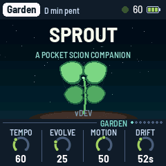

Sprout turns the FM-1 into an instrument for the [Instruo Pocket Scion](https://www.instruomodular.com/), which plays MIDI notes from the signals of plants, fungi and soil. Each of the Scion's five voices (MIDI channels 1–5) rings an FM bell on the FM-1, and **eight animated scenes** answer every note. Underneath, AMB-1's generative ambient music can play as a quiet bed — or not at all: Sprout starts silent.

**Project page:** <https://ephio.github.io/Sprout/> · **Download:** [Releases](https://github.com/Ephio/sprout/releases) · **Documentation:** [docs/SCION.md](docs/SCION.md) (Italian)

## The eight scenes

Switch with PRESETS, or with a MIDI Program Change (0–7). The first four are made for the Pocket Scion's four presets; the other four keep AMB-1's generative music.

<table>
<tr>
<td align="center">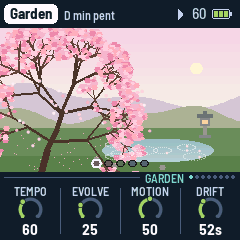 <b>1 Garden</b> D minor pentatonic · cherry blossom, pond</td>
<td align="center">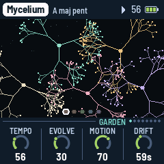 <b>2 Mycelium</b> A major pentatonic · five fungal networks</td>
<td align="center">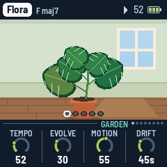 <b>3 Flora</b> F major 7 · a Monstera living its whole life</td>
<td align="center">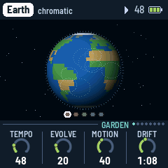 <b>4 Earth</b> chromatic · a turning globe, raindrops</td>
</tr>
<tr>
<td align="center">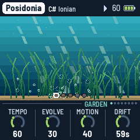 <b>5 Posidonia</b> a seagrass meadow, broken sunbeams</td>
<td align="center">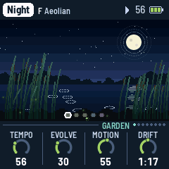 <b>6 Night</b> a river by moonlight, fireflies</td>
<td align="center">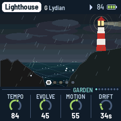 <b>7 Lighthouse</b> a storm, the beam sweeping</td>
<td align="center">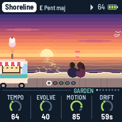 <b>8 Shoreline</b> sunset from the sea wall</td>
</tr>
</table>

## Using it with the Pocket Scion

Connect the Scion to the FM-1 with a TRS MIDI cable (or USB). In the Pocket SCION Controller app choose **Multi Channel**, voices on channels 1–5.

| Message | Effect |
| --- | --- |
| Note On, ch 1–5 | rings an FM bell with that channel's colour and stereo position; the scene answers |
| Control Change | through the **CC map** (by default CC 71–75 set the tone of voices 1–5) |
| Program Change 0–7 | picks the scene |
| Clock · Start · Stop | as in AMB-1 |

The FM-1's keys play notes on the voice shown (SELECT picks the voice, 1–5); a ring marks it under the scene.

### New pages

<table>
<tr>
<td width="50%">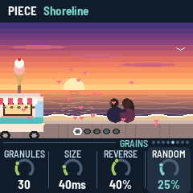 <b>Granulator</b> (SEQ): Granules, Size, Reverse, Random. It replays the last 1.4 s of the sound in grains.</td>
<td width="50%">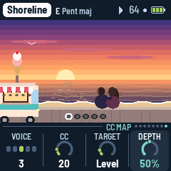 <b>CC map</b> (GLO, twice): for each Scion voice, which CC, where it goes (the voice's tone, level, decay, pan, pitch, or an effect) and how far.</td>
</tr>
</table>

## Status

**Beta.** Tried in the simulator and in the online FM-1 emulator. The behaviour of the Pocket Scion's CCs on a real FM-1 has **not** been verified yet. Unofficial firmware, used at your own risk: the installer also lets you reinstall the original M-VAVE firmware.

Planned: scales chosen on the FM-1 (so the Scion can send all twelve notes), an effects page (delay, reverb, wobble, granules, low pass), LFOs on the CCs, per-voice instruments, MIDI channels per voice.

## Building

Sprout builds like AMB-1: see [BUILDING.md](BUILDING.md). The GitHub workflow in `.github/workflows/release.yml` builds the firmware (`Actions → Build and attest firmware → Run workflow`); the package contains `amb.fwsc` (the build's internal file name, kept from AMB-1).

AMB-1's own manual describes the pages and knobs Sprout inherits: <https://charlesvestal.github.io/fm1-amb/manual/>.

## Credits and licence

By **Paolo Pino**, derived from **AMB-1** by Charles Vestal, built on **fm1-base** and **felucca-bsp**, from **Felucca** by Leo Kuroshita (Hügelton Instruments). MPL-2.0, as AMB-1 — see [LICENSE](LICENSE) and [LICENSING.md](LICENSING.md). Not affiliated with or endorsed by M-VAVE or Instruo; product names belong to their owners.

---

## In italiano

**Sprout** è un firmware beta per l'M-VAVE FM-1 che ascolta il Pocket Scion di Instruo: le cinque voci dello Scion (canali MIDI 1–5) suonano campane FM, e otto scene animate rispondono a ogni nota. Parte in silenzio; il letto ambient generativo di AMB-1 si avvia con PLAY. Le pagine nuove sono il granulatore (tasto SEQ) e la mappa dei CC (tasto GLO premuto due volte). Documentazione: [docs/SCION.md](docs/SCION.md). Pagina del progetto: <https://ephio.github.io/Sprout/>.
